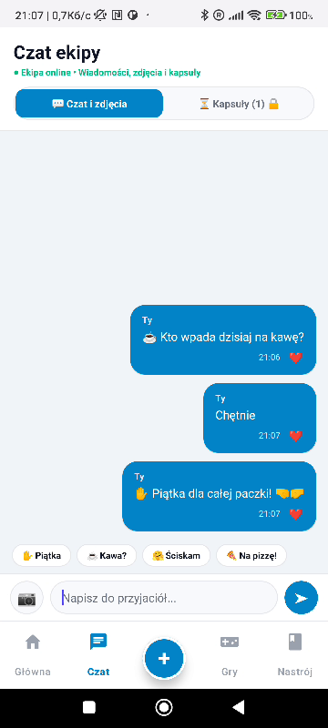
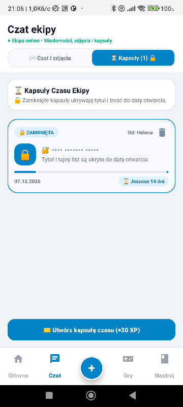
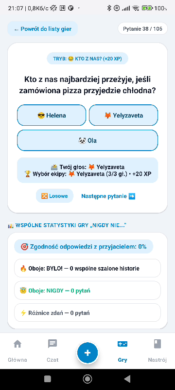
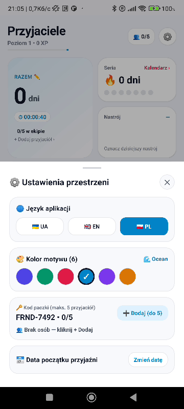

# Friends

Aplikacja mobilna na system Android napisana w języku Kotlin. Umożliwia małej grupie znajomych (do 5 osób połączonych wspólnym kodem pokoju) prowadzenie wspólnego czatu, zapisywanie kapsuł czasu, rozwiązywanie gier pytaniowych oraz śledzenie nastroju.

- **Pakiet aplikacji:** `pl.edu.friends`
- **Autor:** Yelyzaveta Kondratiuk (nr albumu: 100353), Uniwersytet WSB Merito we Wrocławiu

## Główne funkcje

- **Ekran główny (`HomeFragment`):** licznik czasu trwania znajomości (dni i zegar), zarządzanie grupą do 5 osób pod wspólnym kodem, naliczanie punktów XP oraz serii dni aktywności z kalendarzem, losowanie pomysłów na spotkania oraz podgląd kapsuł czasu i ostatniego nastroju.
- **Czat i kapsuły czasu (`ChatFragment`):** czat grupowy z wysyłaniem wiadomości, polubieniami i zdjęciami z galerii oraz moduł kapsuł czasu (wiadomości z przyszłą datą odblokowania, ukrytą treścią do momentu otwarcia i cyklicznym sprawdzaniem w tle).
- **Gry pytaniowe (`GamesFragment`):** 4 tryby gier (*Nigdy nie...*, *Kto z nas częściej?*, *To czy tamto*, *Rozmowy po zmroku*), 420 pytań (po 105 w każdym trybie w 3 językach: PL, UA, EN), losowanie pytań i podgląd statystyk zgodności.
- **Dziennik nastroju (`JournalFragment`):** ocena nastroju w skali 1–5 z limitem maksymalnie 5 wpisów dziennie, wyliczanie średniej oceny oraz wykres z ostatnich 7 dni (`WarmthWaveChartView`).
- **Ustawienia i szybkie akcje (`MainActivity`):** okno szybkich akcji pod przyciskiem `+` na dolnym pasku nawigacji, zmiana języka (PL, UA, EN) oraz wybór jednego z 6 motywów kolorystycznych.

## Realizacja i użyte biblioteki

- **Język i środowisko:** Kotlin 1.9.24 (JVM 17), Android (`minSdk = 26`, `targetSdk = 34`, `compileSdk = 34`), widoki XML z `ViewBinding`, Gradle 8.7 (AGP 8.5.2), KSP 1.9.24-1.0.20.
- **Architektura:** wzorzec MVVM (`ViewModel`, `LiveData`, warstwa repozytorium) oparty na pojedynczej aktywności `MainActivity` i 4 fragmentach.
- **Baza danych i praca w tle:** Room SQLite (`AppDatabase`, 5 encji: `FriendshipProfileEntity`, `TimeCapsuleEntity`, `ChatMessageEntity`, `QuizAnswerEntity`, `JournalEntryEntity`), `SharedPreferences` do zapisu języka i motywu (`AppLocale`, `AppTheme`, `RoomPrefs`), autorski wykres na `Canvas` (`WarmthWaveChartView`) oraz zadania w tle przez `WorkManager` (`CapsuleCheckWorker`, co 12 godzin) z powiadomieniami (`NotificationHelper`).

| Biblioteka | Wersja | Zastosowanie |
| :--- | :--- | :--- |
| `androidx.core:core-ktx` | `1.13.1` | Rozszerzenia Kotlin i obsługa powiadomień |
| `androidx.appcompat:appcompat` | `1.7.0` | Wsparcie kompatybilności aktywności |
| `com.google.android.material:material` | `1.12.0` | Komponenty Material 3, karty, dialogi, nawigacja dolna |
| `androidx.constraintlayout:constraintlayout` | `2.1.4` | Układy widoków XML |
| `androidx.fragment:fragment-ktx` | `1.7.1` | Obsługa fragmentów i `ViewModel` |
| `androidx.recyclerview:recyclerview` | `1.3.2` | Listy wiadomości czatu i kapsuł czasu |
| `androidx.lifecycle:lifecycle-*-ktx` | `2.7.0` | `ViewModel`, `LiveData` oraz `lifecycleScope` |
| `kotlinx-coroutines-android` | `1.8.1` | Asynchroniczne zapytania do bazy danych |
| `androidx.room:room-*` (KSP) | `2.6.1` | Lokalna baza danych SQLite |
| `androidx.work:work-runtime-ktx` | `2.9.0` | Cykliczne sprawdzanie odblokowania kapsuł w tle |
| `com.github.PhilJay:MPAndroidChart` | `v3.1.0` | Wsparcie wykresów i statystyk |

## Struktura projektu

- `FriendsApplication.kt` – inicjalizacja kanału powiadomień i okresowego zadania `WorkManager`
- `data/` – definicja bazy `AppDatabase`, DAO, repozytorium oraz 5 encji Room
- `notifications/` – `CapsuleCheckWorker` i `NotificationHelper`
- `ui/` – `MainActivity`, 4 fragmenty, adaptery `RecyclerView`, `ViewModel`, `WarmthWaveChartView`
- `util/` – obsługa języków (`AppLocale`), motywów (`AppTheme`), preferencji (`RoomPrefs`) oraz banki pytań
- `res/` – układy XML, style (`Theme.Friends`), kolory i zasoby tekstowe

## Zrzuty ekranu

<table>
  <tr>
    <td align="center"> Rys. 1. Ekran główny aplikacji.</td>
    <td align="center"> Rys. 2. Ekran czatu grupowego.</td>
  </tr>
  <tr>
    <td align="center"> Rys. 3. Zakładka kapsuł czasu.</td>
    <td align="center"> Rys. 4. Rozgrywka w trybie „Kto z nas częściej?”.</td>
  </tr>
  <tr>
    <td align="center"> Rys. 5. Dziennik nastroju z limitem dziennym 5/5.</td>
    <td align="center"> Rys. 6. Okno ustawień języka i motywu.</td>
  </tr>
</table>

## Nagranie działania aplikacji

- [Nagranie ekranu aplikacji (MP4)](demo/friends_demo.mp4)

Na nagraniu zaprezentowano zmianę języka na polski, wybór motywu kolorystycznego, ustawienie daty rozpoczęcia znajomości, dodanie członków grupy, utworzenie zapieczętowanej kapsuły czasu, wysłanie wiadomości na czacie, udzielanie odpowiedzi w quizie oraz zapisywanie ocen nastroju.

## Uruchomienie

1. Otworzyć katalog główny projektu w **Android Studio** (JDK 17, `compileSdk = 34`) i zsynchronizować Gradle.
2. Uruchomić projekt na telefonie lub emulatorze albo zainstalować plik `app/build/outputs/apk/debug/app-debug.apk`.
