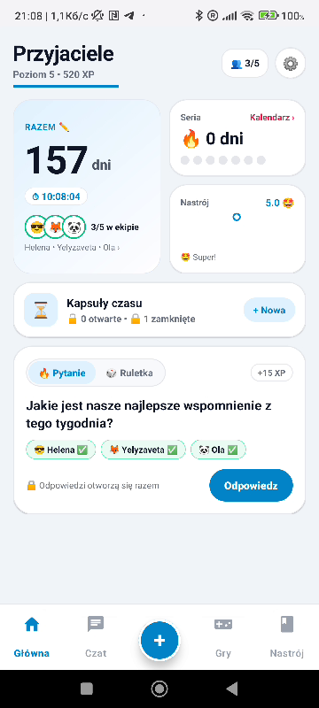
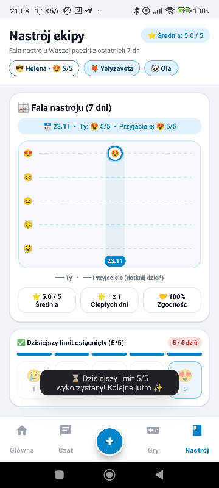

# Friends – aplikacja mobilna (Android)

Natywna aplikacja mobilna na system Android stworzona dla małej grupy przyjaciół (do 5 osób pod wspólnym kodem pokoju), łącząca wspólny czat, kapsuły czasu, gry towarzyskie oraz dziennik nastroju z analizą aktywności grupy.

- **Pakiet aplikacji:** `pl.edu.friends`
- **Autorka:** Yelyzaveta Kondratiuk (nr albumu: `100353`), Uniwersytet WSB Merito we Wrocławiu

---

## Główne funkcje

- **Ekran główny (`HomeFragment`, układ Bento Grid):** licznik czasu trwania przyjaźni na żywo (dni oraz `godz.:min.:sek.`), podgląd składu grupy do 5 osób pod wspólnym kodem pokoju, poziomy XP i seria aktywnych dni (*Streak*) z kalendarzem, szybkie interakcje (`+10 XP`), losowy generator pomysłów na spotkanie, podsumowanie kapsuł czasu oraz mini-wykres nastroju.
- **Czat i Kapsuły Czasu (`ChatFragment`):** czat grupowy z reakcjami i zdjęciami oraz **Kapsuły Czasu** — wiadomości z zaplanowaną datą odblokowania w przyszłości, ukrytą treścią przed upływem terminu, paskiem postępu i odliczaniem czasu; odblokowanie jest cyklicznie sprawdzane w tle przez `WorkManager`.
- **Gry i quizy (`GamesFragment`):** 4 tryby gier (*Nigdy nie...*, *Kto z nas częściej?*, *To czy tamto*, *Rozmowy po zmroku*), łącznie **420 unikalnych pytań** (po 105 pytań na grę w 3 językach: **PL / UA / EN**), przycisk losowania pytań oraz statystyki zgodności odpowiedzi (`+20 XP`).
- **Dziennik nastroju (`JournalFragment`):** ocena dziennego nastroju w skali `1–5` z limitem maksymalnie **5 reakcji dziennie**, wyliczanie średniej oceny, autorski wykres falowy (`WarmthWaveChartView`), 15 pytań dnia oraz historia wpisów.
- **Szybkie akcje (`+`) i Personalizacja (`⚙️`):** szybkie dodawanie treści bezpośrednio z dolnego paska nawigacji (`MainActivity`), przełączanie 3 języków interfejsu (`PL`, `UA`, `EN` w `AppLocale`) oraz wybór spośród 6 spokojnych motywów kolorystycznych (*Indygo, Szałwia, Róża, Ocean, Ametyst, Piasek* w `AppTheme`).

---

## Technologie i realizacja

- **Język i platforma:** Kotlin `1.9.24` (JVM target `17`), natywny Android (`minSdk = 26`, `targetSdk = 34`, `compileSdk = 34`), widoki **XML + ViewBinding**.
- **System budowania:** Gradle `8.7`, Android Gradle Plugin `8.5.2`, KSP `1.9.24-1.0.20`.
- **Architektura:** **MVVM** (`ViewModel` + `LiveData` + `Repository` + Room SQLite); pojedyncza aktywność `MainActivity` zarządzająca 4 fragmentami (`HomeFragment`, `ChatFragment`, `GamesFragment`, `JournalFragment`).
- **Baza danych (`AppDatabase`, Room v3, 5 tabel):** `FriendshipProfileEntity`, `TimeCapsuleEntity`, `ChatMessageEntity`, `QuizAnswerEntity`, `JournalEntryEntity`.
- **Grafika, preferencje i praca w tle:** autorski wykres na `Canvas` (`WarmthWaveChartView`), trwały zapis języka, motywu i preferencji pokoju w `SharedPreferences` (`AppLocale`, `AppTheme`, `RoomPrefs`) oraz periodyczne zadanie w tle (`CapsuleCheckWorker` uruchamiane przez `WorkManager` co 12 godzin) z lokalnymi powiadomieniami (`NotificationHelper`).

### Użyte biblioteki

| Obszar | Biblioteka / artefakt | Wersja | Zastosowanie |
| :--- | :--- | :--- | :--- |
| Podstawowe API Android | `androidx.core:core-ktx` | `1.13.1` | Rozszerzenia Kotlin i obsługa powiadomień |
| Kompatybilność i UI | `androidx.appcompat:appcompat` | `1.7.0` | Bazowa aktywność i obsługa zasobów |
| Material Design | `com.google.android.material:material` | `1.12.0` | Komponenty **Material 3**, karty, dialogi, nawigacja |
| Układy widoków | `androidx.constraintlayout:constraintlayout` | `2.1.4` | Elastyczne układy XML bez głębokiego zagnieżdżania |
| Fragmenty i listy | `androidx.fragment:fragment-ktx`, `androidx.recyclerview:recyclerview` | `1.7.1`, `1.3.2` | Obsługa 4 zakładek oraz list czatu, kapsuł i dziennika |
| Cykl życia i MVVM | `androidx.lifecycle:lifecycle-{viewmodel,livedata,runtime}-ktx` | `2.7.0` | `ViewModel`, `LiveData`, `lifecycleScope` |
| Asynchroniczność | `org.jetbrains.kotlinx:kotlinx-coroutines-android` | `1.8.1` | Operacje bazodanowe i zadania w tle |
| Baza danych SQLite | `androidx.room:room-{runtime,ktx,compiler}` (KSP) | `2.6.1` | Lokalna persystencja 5 encji i zapytań `LiveData` |
| Zadania w tle | `androidx.work:work-runtime-ktx` | `2.9.0` | Cykliczne sprawdzanie odblokowania kapsuł czasu |
| Wykresy statystyk | `com.github.PhilJay:MPAndroidChart` | `v3.1.0` | Wsparcie wizualizacji danych i statystyk |

---

## Struktura projektu

```text
app/src/main/java/pl/edu/friends/
├── FriendsApplication.kt          # Inicjalizacja kanału powiadomień i WorkManager (co 12 h)
├── data/                          # Warstwa danych: AppDatabase (v3), DAO, Repository i 5 encji Room
├── notifications/                 # CapsuleCheckWorker oraz NotificationHelper
├── ui/                            # MainActivity, 4 fragmenty, adaptery RecyclerView, ViewModel, WarmthWaveChartView
└── util/                          # AppLocale (PL/UA/EN), AppTheme (6 motywów), RoomPrefs, 4 banki pytań (420)

app/src/main/res/                  # Układy XML (ViewBinding), style Theme.Friends, kolory i zasoby
```

---

## Zrzuty ekranu

<table align="center">
  <tr>
    <td align="center" width="50%">
      <br />
      <sub><b>Rys. 1.</b> Ekran główny (układ Bento Grid: 157 dni przyjaźni, skład 3/5, kapsuły i nastrój)</sub>
    </td>
    <td align="center" width="50%">
      <br />
      <sub><b>Rys. 2.</b> Czat ekipy (wysłane wiadomości, szybkie przyciski i reakcje serduszkiem)</sub>
    </td>
  </tr>
  <tr>
    <td align="center" width="50%">
      <br />
      <sub><b>Rys. 3.</b> Kapsuły Czasu (zapieczętowana kapsuła z ukrytą treścią i odliczaniem 14 dni)</sub>
    </td>
    <td align="center" width="50%">
      <br />
      <sub><b>Rys. 4.</b> Gry i quizy (tryb „Kto z nas?” z głosowaniem na członków grupy i statystykami)</sub>
    </td>
  </tr>
  <tr>
    <td align="center" width="50%">
      <br />
      <sub><b>Rys. 5.</b> Dziennik nastroju (wykres falowy, średnia 5.0 / 5 oraz dzienny limit 5/5 reakcji)</sub>
    </td>
    <td align="center" width="50%">
      <br />
      <sub><b>Rys. 6.</b> Ustawienia przestrzeni (<code>⚙️</code>): zmiana języka na PL oraz 6 motywów kolorystycznych</sub>
    </td>
  </tr>
</table>

---

## Wideo demonstracyjne

[▶️ Obejrzyj nagranie demonstracyjne (demo/friends_demo.mp4, 3:55)](demo/friends_demo.mp4)

Co zostało pokazane na nagraniu:
1. Przełączenie języka aplikacji na **PL** oraz zmiana motywu kolorystycznego na **🌊 Ocean** w Ustawieniach (`⚙️`).
2. Ustawienie daty początku przyjaźni (`157 dni`) oraz dodanie 3 członków grupy pod wspólnym kodem (`Helena`, `Yelyzaveta`, `Ola`).
3. Utworzenie nowej **Kapsuły Czasu** na 14 dni (ukryta treść i tytuł do daty odblokowania).
4. Wysłanie wiadomości na czacie grupowym i reakcje serduszkiem.
5. Rozgrywka i głosowanie w quizie **„Kto z nas częściej?”** z naliczaniem punktów **XP**.
6. Dodawanie ocen w **Dzienniku nastroju** (wykres falowy oraz weryfikacja limitu `5/5` dziennie).
7. Podgląd **Kalendarza serii** oraz losowanie pomysłów na spotkania w **Ruletce**.

---

## Uruchomienie

1. Otwórz katalog główny projektu w **Android Studio** (JDK 17, `compileSdk = 34`, `minSdk = 26`).
2. Wykonaj synchronizację Gradle i uruchom aplikację na urządzeniu fizycznym lub emulatorze (`Run 'app'`).
3. Alternatywnie zainstaluj zbudowany pakiet testowy `app/build/outputs/apk/debug/app-debug.apk` bezpośrednio na telefonie z systemem Android.
